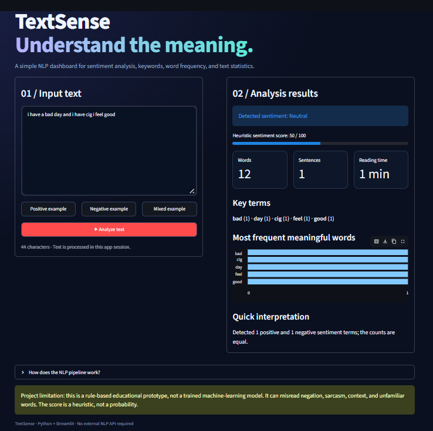

# TextSense: Natural Language Processing Text Sense & Sentiment Analyzer


> **Mini-Project of Natural Language Processing Lab**  
> Submitted in partial fulfillment of the requirements for the Fourth Year of Bachelor of Engineering in **Artificial Intelligence & Data Science**  
> **Rizvi College of Engineering**, Department of Artificial Intelligence & Data Science  
> **University of Mumbai** (Academic Year 2026–2027)

---

## 👨‍🎓 Project Credits & Academic Details

- **Student Name:** Khan Yahya Shahid Ali
- **Roll No:** 28
- **UIN:** 221A048
- **Department:** Department of Artificial Intelligence & Data Science Engineering
- **Institution:** Rizvi College of Engineering, Bandra (W), Mumbai
- **Affiliation:** University of Mumbai
- **Project Guide:** Prof. Vijay Shankar

---

## 📌 Project Overview

**TextSense** is an interactive, web-based Natural Language Processing (NLP) dashboard developed using **Python** and the **Streamlit** framework. The primary goal of TextSense is to automate the analysis of unstructured textual data (such as product reviews, user comments, articles, and customer feedback) without requiring external paid cloud APIs or heavy deep-learning dependencies.

### Key Capabilities:
1. **Rule-Based Sentiment Analysis:** Evaluates polarity (*Positive*, *Negative*, or *Neutral*) and generates a calibrated heuristic sentiment score (0 to 100).
2. **Document & Text Statistics:** Automatically computes total word count, sentence count, character length, and estimated reading time.
3. **Keyword Extraction & Stop-Word Filtering:** Filters grammatical noise (articles, prepositions, auxiliary verbs) and isolates primary semantic key terms.
4. **Word Frequency Distribution:** Generates real-time horizontal bar charts illustrating the most frequent meaningful terms.
5. **Interactive UI Dashboard:** Built-in preset test buttons (*Positive*, *Negative*, *Mixed*) for rapid 1-click evaluation.
6. **Dual Execution Engine:** Fully functional Streamlit interactive web interface with a standalone headless Terminal CLI fallback.

---

## 🏗️ System Architecture & NLP Pipeline

```
[ User Text Input ]
        │
        ▼
[ Tokenization (Regex: \b[a-zA-Z]+\b) ]
        │
        ├───► [ Stop-word Filtering (High-frequency grammatical words removal) ]
        │            │
        │            ▼
        │     [ Keyword Extraction & Term Frequency Counter ] ──► [ Bar Chart Visualization ]
        │
        ├───► [ Lexicon Cross-Referencing (Positive / Negative Vocabularies) ]
        │            │
        │            ▼
        │     [ Term Difference & Heuristic Scoring (0 - 100) ] ──► [ Sentiment Badge (Pos/Neg/Neu) ]
        │
        └───► [ Document Statistics: Sentence Split, Word Count, Reading Time ]
```

---

## 📸 Application Screenshot



---

## 📖 Complete Working & Execution Guide

Follow these steps to run, test, and demonstrate the project on any computer:

### Step 1: Clone the Repository
Open Terminal (macOS/Linux) or Command Prompt (Windows) and clone the repo:
```bash
git clone https://github.com/yxhyxalikhan-dev/textsense-nlp-project.git
cd textsense-nlp-project
```

### Step 2: Set Up Virtual Environment (Recommended)
Creating an isolated environment ensures clean package management:
```bash
# Create virtual environment
python3 -m venv venv

# Activate on macOS/Linux:
source venv/bin/activate

# Activate on Windows:
venv\Scripts\activate
```

### Step 3: Install Required Dependencies
Install the required packages using `requirements.txt`:
```bash
pip install -r requirements.txt
```
*Dependencies installed: `streamlit`, `pandas`, `altair`.*

---

### Step 4: Launch the Streamlit Web Application
Run the following command to start the interactive web dashboard:
```bash
streamlit run app.py
```
After executing, Streamlit will display:
```
  You can now view your Streamlit app in your browser.
  Local URL: http://localhost:8501
  Network URL: http://192.168.x.x:8501
```
Your default web browser will automatically open with the **TextSense** dashboard!

---

### Step 5: How to Use the Web Interface
1. **Entering Text:**
   - On the left panel under **`01 / Input text`**, type or paste any text (customer reviews, articles, sentences, or feedback).
2. **Using 1-Click Preset Examples:**
   - Click **`Positive example`** to test high-sentiment praising text.
   - Click **`Negative example`** to test complaining/defective review text.
   - Click **`Mixed example`** to test balanced text (`"i have a bad day and i have cig i feel good"`).
3. **Analyzing:**
   - Click the red **`✦ Analyze text`** button.
4. **Interpreting Results:**
   - **Detected sentiment:** Green for *Positive*, Red for *Negative*, Blue for *Neutral*.
   - **Heuristic score bar:** Visual progress bar out of 100.
   - **Metrics cards:** Words count, Sentences count, Reading time in minutes.
   - **Key terms:** Top terms with their occurrence count.
   - **Most frequent meaningful words:** Live interactive bar chart.
   - **Quick interpretation:** Summary sentence detailing exact positive vs. negative term distribution.

---

### Step 6: Headless CLI Mode (Without Browser)
If you need to run the application in a headless environment, automated script, or test terminal without a GUI:
```bash
python3 app.py
```
This triggers the built-in CLI engine and prints structured test results for sample inputs directly in the terminal console.

---

## 📊 Sample Test Results

| Test Case | Input Sample | Detected Sentiment | Score | Key Terms Identified |
|---|---|---|---|---|
| **Positive** | *"The product quality is amazing and fantastic! Fast delivery and excellent support."* | **Positive** | 90 / 100 | product (1), quality (1), amazing (1), fantastic (1), fast (1) |
| **Negative** | *"The service was terrible and awful. Very slow response, broken package."* | **Negative** | 10 / 100 | service (1), terrible (1), awful (1), slow (1), response (1) |
| **Mixed / Neutral** | *"i have a bad day and i have cig i feel good"* | **Neutral** | 50 / 100 | bad (1), day (1), cig (1), feel (1), good (1) |

---

## 📂 Repository Structure

```
textsense-nlp-project/
├── app.py                      # Main Streamlit NLP Application & CLI engine
├── requirements.txt            # Python dependencies (streamlit, pandas, altair)
├── README.md                   # Complete Working Guide & project documentation
├── .gitignore                  # Git ignore rules for Python & cache
└── reports/                    # Academic Lab Project Reports
    ├── Khan_Yahya_Shahid_Ali_NLP_Mini_Project_Report.docx  # Official Word Report
    ├── Khan_Yahya_Shahid_Ali_NLP_Mini_Project_Report.pdf   # Print-Ready PDF
    └── Figure1_TextSense_Dashboard.png                    # Application UI Screenshot
```

---

## 🔧 Troubleshooting Guide

- **Issue:** `streamlit: command not found`  
  **Solution:** Ensure you ran `pip install -r requirements.txt`. If still unresolved, run `python3 -m streamlit run app.py`.
- **Issue:** `Port 8501 is already in use`  
  **Solution:** Run on another port using `streamlit run app.py --server.port 8502`.
- **Issue:** Browser does not open automatically  
  **Solution:** Manually open Chrome, Safari, or Edge and navigate to `http://localhost:8501`.

---

## ⚠️ Limitations & Future Scope

- **Rule-Based Limitation:** As an educational prototype utilizing lexicon matching, the model may misinterpret sarcasm, double negation (e.g., *"not bad"*), or colloquial internet slang.
- **Future Scope:** Integration of transformer-based embeddings (BERT / RoBERTa / DistilBERT), VADER sentiment intensity scoring, and multilingual tokenization.

---

## 📜 Academic Declaration

This submission represents bonafide academic work developed by **Khan Yahya Shahid Ali (221A048 / Roll No: 28)** for the **Natural Language Processing Lab Mini-Project**, Department of Artificial Intelligence & Data Science Engineering, Rizvi College of Engineering, affiliated with the University of Mumbai.
